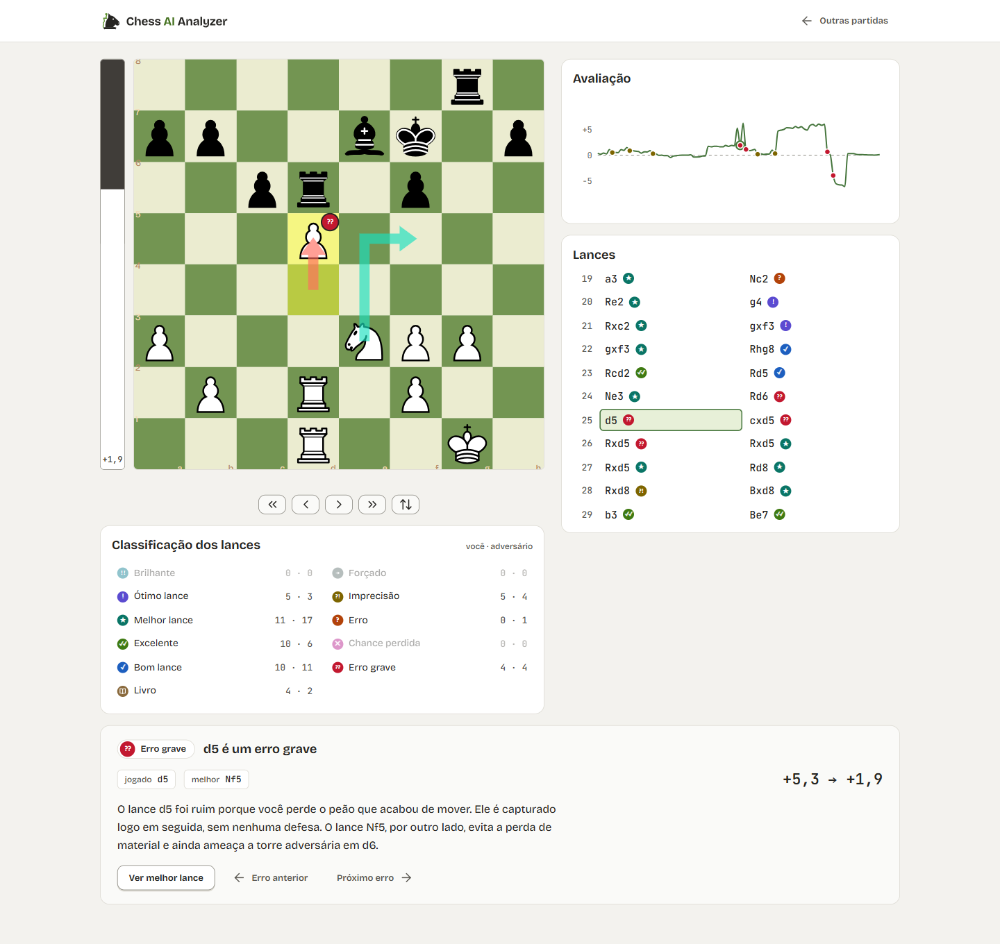
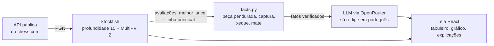
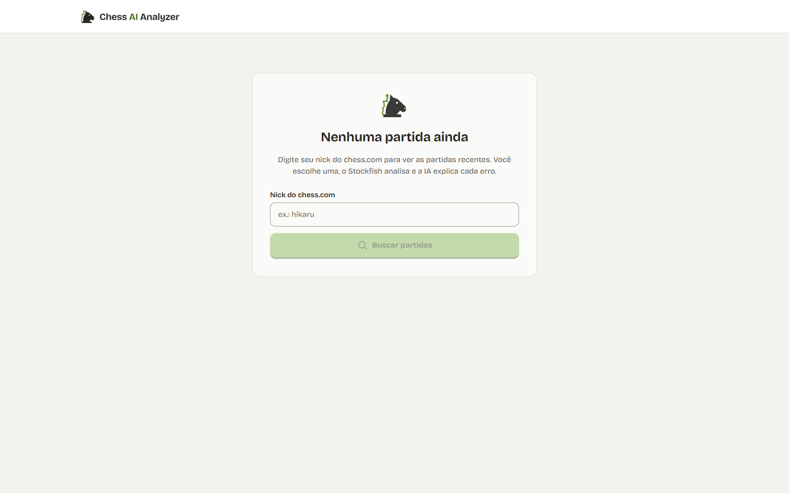
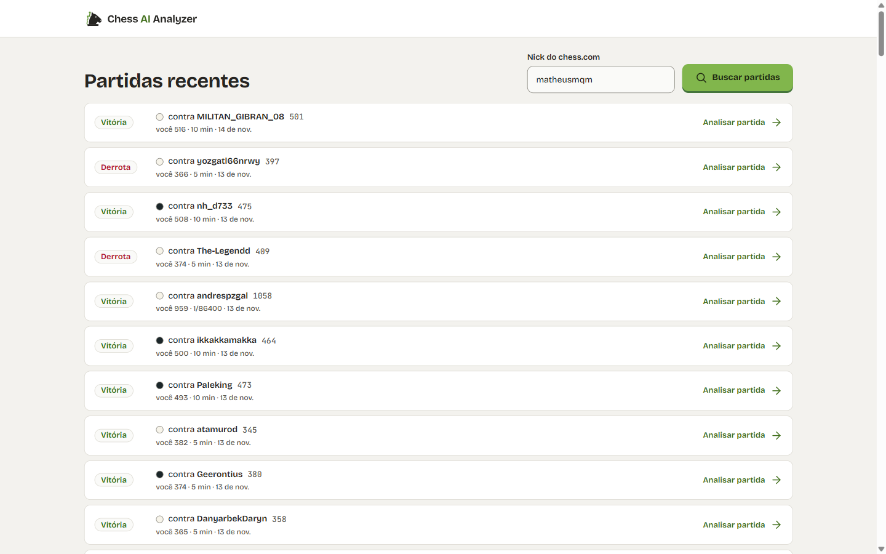
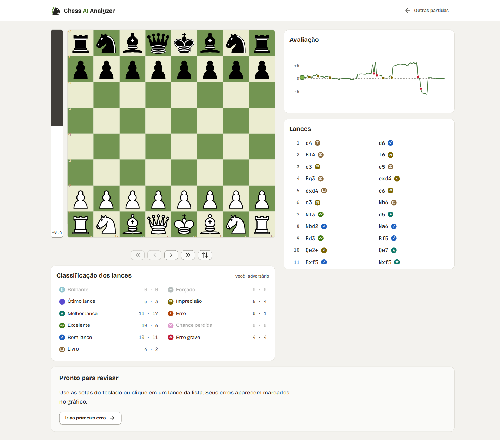

# Chess AI Analyzer

**Descubra por que você perdeu a partida.** Digite seu nick do chess.com, escolha uma partida e receba uma revisão completa: o Stockfish classifica cada lance e uma IA explica seus erros em português, em linguagem de gente.



## A ideia: o LLM não analisa xadrez

Modelos de linguagem erram muito em xadrez: inventam táticas, citam peças que não existem, "explicam" lances sem ter calculado nada. Então aqui o LLM **não** analisa a posição. Quem calcula é o Stockfish, e quem transforma o cálculo em fatos concretos é código determinístico (`python-chess`). O modelo só **traduz** esses fatos para texto.



Para cada erro, o prompt leva só o que foi calculado: posição (FEN), lance jogado, melhor lance, linhas do motor e uma lista de fatos como *"seu cavalo em f3 fica sem defesa, capturado por peão em e4"*. O prompt do sistema proíbe citar avaliações, inventar variantes ou justificar o lance sem base nos fatos. Se os fatos não explicam o motivo, o texto diz só o que está confirmado.

### Exemplo real

> **d5 é um erro grave** (jogado `d5`, melhor `Nf5`, avaliação +5,3 → +1,9)
>
> O lance d5 foi ruim porque você perde o peão que acabou de mover. Ele é capturado logo em seguida, sem nenhuma defesa. O lance Nf5, por outro lado, evita a perda de material e ainda ameaça a torre adversária em d6.

## O que o app faz

- **Lista suas partidas recentes** do chess.com (últimos 2 meses), com resultado, ratings e ritmo de jogo.
- **Classifica todos os lances dos dois lados**, no estilo do chess.com, em 11 categorias.
- **Explica em português** cada erro, chance perdida e erro grave **seu** (os lances do adversário são classificados, mas não explicados).
- **Gráfico de avaliação** da partida inteira, com os erros marcados. Clique para pular para o lance.
- **Tabuleiro navegável**: setas do teclado, setas do melhor lance (verde) e do lance jogado (vermelho), barra de avaliação e botão para girar.
- **Explore variações**: use "Ver melhor lance" ou arraste peças para testar outra ideia a partir da posição.
- **Navegação entre erros** (anterior e próximo) e resumo da classificação, você × adversário.
- **Cache em SQLite**: uma partida já analisada abre na hora, sem rodar o Stockfish nem chamar o LLM de novo.

<table>
  <tr>
    <td width="50%"></td>
    <td width="50%"></td>
  </tr>
  <tr>
    <td align="center">Digite o nick</td>
    <td align="center">Escolha uma partida</td>
  </tr>
</table>



## Como os lances são classificados

A perda é medida em centipawns (centésimos de peão) do ponto de vista de quem jogou, comparando a avaliação antes e depois do lance.

| Categoria | Critério |
|---|---|
| **Brilhante** `!!` | Sacrifício de peça (perda líquida de pelo menos 2 peões) sem piorar a posição (perda ≤ 10), sem já estar ganhando muito nem perdendo |
| **Ótimo lance** `!` | É o melhor lance e o 2º melhor é pelo menos 200 cp pior; recapturas não contam |
| **Melhor lance** `★` | Igual ao 1º lance do motor |
| **Excelente** | Perda de 0 a 19 cp |
| **Bom lance** | Perda de 20 a 49 cp |
| **Livro** | Até o 12º lance (ply) com perda menor que 20 cp (aproximação, sem livro de aberturas real) |
| **Forçado** | Era o único lance legal (tem prioridade sobre as demais) |
| **Imprecisão** `?!` | Perda de 50 a 99 cp |
| **Erro** `?` | Perda de 100 a 299 cp |
| **Chance perdida** | Erro logo depois de o adversário errar (≥ 150 cp), estando com vantagem |
| **Erro grave** `??` | Perda de 300 cp ou mais |

Mates são convertidos para ±10000 cp, então um mate perdido ou evitado entra na mesma conta.

## Stack

| Camada | Tecnologias |
|---|---|
| Backend | Python, FastAPI, `python-chess`, `httpx`, SQLite (módulo `sqlite3` da stdlib) |
| Frontend | React, Vite, TypeScript, `react-chessboard`, `chess.js`, `recharts` |
| Motor | Stockfish local (UCI) |
| LLM | OpenRouter (API compatível com OpenAI), modelo configurável, com modelos de reserva |

## Como rodar

### Pré-requisitos

- Python 3.11 ou superior (desenvolvido em 3.14)
- Node.js
- [Stockfish](https://stockfishchess.org/download/) instalado localmente
- Uma chave do [OpenRouter](https://openrouter.ai/) (opcional: sem ela a análise roda normalmente, só que sem as explicações)

### Configuração

Copie o `.env.example` para `.env` na raiz do projeto e preencha:

```
STOCKFISH_PATH=/caminho/para/stockfish
OPENROUTER_API_KEY=sua-chave
OPENROUTER_MODEL=modelo-barato-e-bom-em-portugues
```

O `.env` não é versionado.

### Subindo o projeto

```bash
# backend (http://localhost:8000)
cd backend
pip install -r requirements.txt
uvicorn main:app --reload

# frontend (http://localhost:5173), em outro terminal
cd frontend
npm install
npm run dev
```

Abra `http://localhost:5173`, digite seu nick e escolha uma partida.

### Testes

Cobrem a lógica que erra fácil: classificação por centipawns, conversão de mate, detecção de sacrifício e geração dos fatos.

```bash
cd backend
pip install pytest
python -m pytest
```

### Só no terminal

Para ver os erros da sua partida mais recente sem a interface: `python engine.py <nick>` dentro de `backend/`.

## API

| Rota | O que faz |
|---|---|
| `GET /api/games?username=...` | Partidas recentes do jogador |
| `POST /api/analyze` com `{ "game_url": "...", "username": "..." }` | Analisa a partida e devolve lances, avaliações, classificação e explicações |
| `GET /api/analysis?game_url=...` | Devolve a análise do cache, se existir |

## Estrutura

```
backend/
├── main.py         # rotas FastAPI
├── chesscom.py     # cliente da API pública do chess.com
├── engine.py       # Stockfish + classificação dos lances
├── facts.py        # fatos concretos de cada erro (peça pendurada, captura, xeque...)
├── explain.py      # prompts e chamadas ao OpenRouter
├── db.py           # cache das análises em SQLite
└── test_engine.py  # testes
frontend/src/       # App, Board, EvalChart, MoveList, ExplanationPanel, ...
```

## Decisões de projeto

- **Dados primeiro, texto depois.** O LLM recebe fatos já verificados, não a partida. Isso reduz as alucinações típicas de "IA explicando xadrez".
- **Resiliência nas explicações.** As chamadas rodam em paralelo com concorrência limitada, com repetição em caso de falha, modelos de reserva e um teto de tempo. Se uma explicação falhar, a análise continua e o app avisa.
- **Só cacheia análise completa.** Análises com aviso (sem chave do LLM ou com explicações que falharam) não vão para o cache, então a próxima tentativa refaz tudo em vez de guardar um resultado pela metade.
- **Simples de propósito.** Sem login, sem Docker, sem fila de tarefas: é uma ferramenta pessoal que roda local.

## Limitações

- Roda só localmente, sem login e sem deploy.
- Só chess.com, uma partida por vez.
- A análise é síncrona: a tela espera o fim da análise e das explicações, o que pode levar alguns minutos.
- A categoria "Livro" é uma aproximação (não usa um livro de aberturas real).
- A qualidade do texto depende do modelo escolhido.

## Licença

[MIT](LICENSE)
